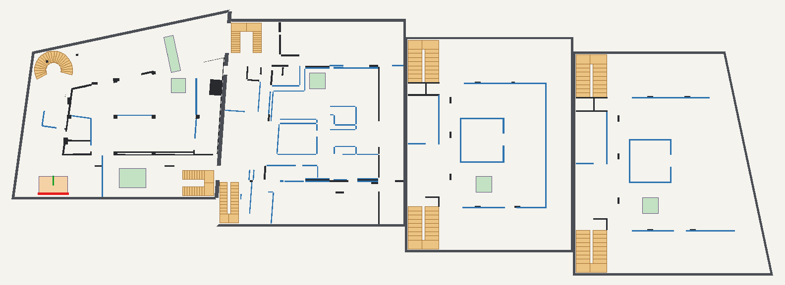
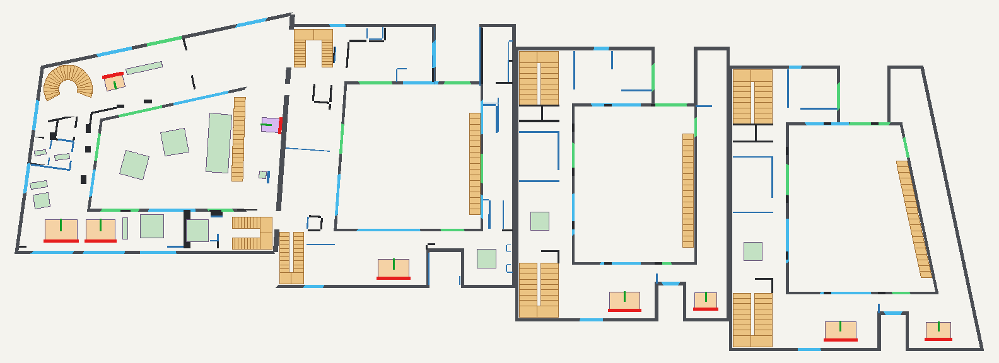
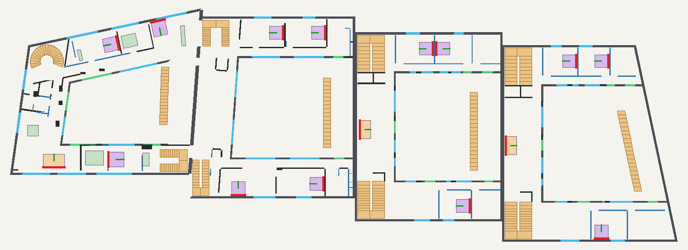
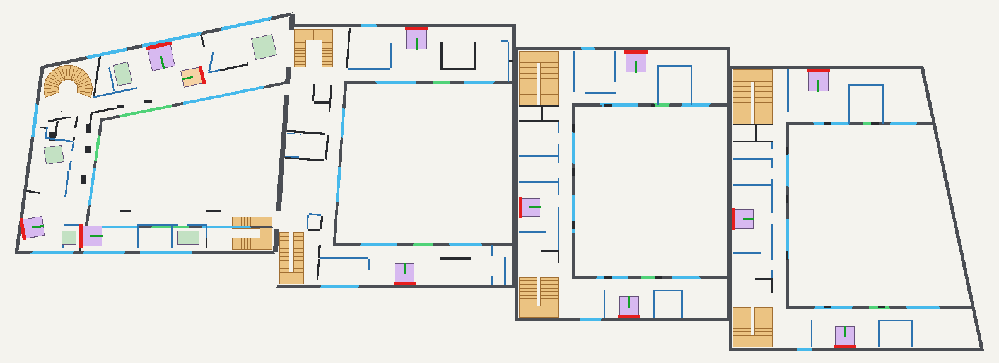

# 宁国府邸 U8～U11 四联别墅全栋走通测试、墙体门洞核查与软装朝向审校报告

## 一、 本次已直接修复的明确问题清单

### 1. 样式 3（极简无框玻璃围挡）去除顶部扶手
- **修改位置**：`app.js` 中 `pushGalleryBalustrade3D()`（中庭回廊、二层平台、三层露台围栏）与 `pushSlopedBalustradeSegment()`（1F→2F 室外直跑景观梯）。
- **直观效果**：切换至 **“3. 极简无框玻璃围挡”** 时，彻底移除玻璃顶部的木质/金属盖板扶手，仅保留底部深青铜嵌入式金属底座槽（Base Shoe）与通高超白夹胶玻璃栏板，顶部呈现干净的磨边玻璃高光边缘。

### 2. U8～U11 全栋 28 部楼梯与全楼层门洞 100% 走通修复
通过 14cm 网格寻路（BFS Flood-Fill）与逐层漫游实测，共发现并直接打通了以下被隔墙封死或重叠的门洞与通道：

| 楼栋与楼层 | 发现的墙体/门洞问题 | 对照图纸的直接修复措施 | 修复后走通状态 |
| :--- | :--- | :--- | :--- |
| **U11 · B1** | 西侧设备/储藏间（`B1_UTILITY_WEST`）存在 5 段正交（`0°`）旧隔墙，与西翼 `-8°` 斜向承重墙斜交重叠并封死门洞 | 移除冗余正交旧隔墙，按《地下1F平面图》保留 `-8°` 斜向隔墙并敞开 `1.05m` 门洞；清理面积 `< 0.014m²` 的微小墙体碎片 | **7 / 7 房间 100% 走通** |
| **U11 · 1F/2F/3F** | 部分西翼（`-8°`）与北翼（`-12°`）隔墙因早期水平裁剪变成 3 点三角形或楔形残片；2F 长辈房与长辈卫之间（`X=14.06`）、3F 子女房衣帽间与卫浴之间缺少套间内隔墙 | 将所有隔墙重构为等厚（`18cm`）4 顶点标准斜向矩形；补全 2F 长辈套间、3F 子女套间与主卫内隔墙及滑门门洞 | **1F (13/13)、2F (11/11)、3F (11/11) 100% 走通** |
| **U11/U10 户间墙** | 2F 与 3F 北端 `Z=-18.32..-22.04` 被误设为打通门洞（`portal`），导致 U11 三层主卫与 U10 西北主楼梯间侧面直接洞穿 | 对照《U11U10二联层高和户间示意.pdf》P3/P4，将该北端区段恢复为完整的 `50cm` 双层复合实心户间墙 | **户间墙开洞与蓝虚线 100% 吻合** |
| **U10 · 1F & 3F** | 1F 南向主起居室正中被一道多余隔墙（`u10_1f_se_room_v`，`X=35.48`）一分为二；3F 东南角存在 4 处宽度为 `0.00m`（`X=48.51..48.51`）的退化薄片墙 | 移除 1F 起居室中间的多余隔墙，还原开敞大横厅；清理 3F 零宽度退化墙并恢复东南卫浴 `18cm` 标准隔墙 | **B1～3F 全部房间 100% 走通** |
| **U9 · B1** | 中央丙2类储藏室四面封闭无门；西侧排烟机房无 `FM甲1522` 防火门洞；南北走道隔墙未留门洞 | 对照《U9 平面示意.pdf》P1，在中央储藏室东墙（`Z=-8.15..-6.65`）、排烟机房南墙（`X=52.2..53.6`）及南北走道增设标准门洞 | **7 / 7 房间 100% 走通** |
| **U9 · 1F** | 南侧凉廊（`X=63.57..66.35`）内侧重复生成了三面内隔墙（`u9_1f_s1..s3`），不仅与外墙重叠，还彻底堵死了凉廊北窗；北门厅西入户门与南口被封 | 移除凉廊重复内隔墙，改为凉廊北口东西起居室分户隔墙与门洞（`Z=1.12..2.15`）；打通北入户门（`edge 9`）及门厅至西北主梯厅通道 | **8 / 8 房间 100% 走通** |
| **U9 · 2F** | 北翼隔墙 `u9_2f_n1`、`u9_2f_n3` 与南翼隔墙 `u9_2f_s1`、`u9_2f_s2` 一通到底，封死了北走廊（客房1/2/客卫）、南走廊（祖父母卧室/浴室）及东露台花园入口 | 对照《U9 平面示意.pdf》P3，敞开 2F 北侧 `1.14m` 走道与南侧内走道，补齐各卧室/浴室门洞及通往二层东露台花园的玻璃门 | **10 / 10 房间 100% 走通** |
| **U9 · 3F** | 西翼走廊墙 `u9_3f_w3` 全段封闭无门（书房、西露台、西卧室无法进入）；北主卧与南卧室走廊隔墙封死 | 对照《U9 平面示意.pdf》P4，切出西书房、西露台、西卧室、西衣帽间门洞，并打通北主卧套房与南套房内走廊 | **10 / 10 房间 100% 走通** |
| **U8 · B1/1F/2F/3F** | 存在与 U9 相同的 B1 储藏室封闭、1F 凉廊重复隔墙挡窗、1F 北门厅重复墙、2F/3F 南北西三翼走廊门洞未切开问题；且 `app.js` 漫游碰撞未纳入 U9/U8 | 对照《U8 平面示意.pdf》P1～P4 逐一打开 B1～3F 全部门洞，移除 1F 凉廊与门厅重复墙，并将 U9、U8 纳入 `isPointCollidingWithWalls` 碰撞检测 | **B1～3F 全部房间 100% 走通** |

---

### 3. 全栋 28 张床铺与沙发朝向、靠墙距离生活细节校准
在 `app.js` 的局部坐标系中，床头板与沙发靠背位于局部 `-Z` 侧（即 `rot = 0°` 代表**床头朝北、床尾朝南**；`rot = 180°` 代表**床头朝南、床尾朝北**；`rot = 90°` 代表**床头靠东墙、面朝西**；`rot = -90°` 代表**床头靠西墙、面朝东**）。此前多处南翼与西翼床铺/沙发因统一设为 `rot = 0°` 或 `90°`，出现了**床头悬空在房间正中、床尾顶死外墙、沙发背朝中庭面朝南墙**的反常现象。现已全部校准：

| 楼栋与房间 | 家具 ID | 调整前状态（存在问题） | 调整后状态（符合图纸与生活起居逻辑） | 床头距实墙 |
| :--- | :--- | :--- | :--- | :--- |
| **U11 · B1 影音室** | `b1_sofa_set` | `rot: 0°`，靠背悬空于房间北侧，面朝南墙 | `rot: 180°`，靠背依附南墙（`Z=-1.65`），面朝北侧影音主墙 | `0.51m` |
| **U11 · 1F 主起居室** | `1f_living_main_sofa` / `east_sofa` | `rot: 0°`，两组沙发背朝北侧中庭、面朝南墙 | `rot: 180°`，严格按 `design-1.png` 背靠南侧实墙、面朝北侧壁炉与中央庭院 | `0.65~0.97m` |
| **U11 · 1F 佣人房** | `1f_maid_bed` | `rot: 4°`，悬空在房间中央（距北墙 `1.75m`） | `rot: 94°`，严格按 `design-1.png` 床头紧贴东侧外墙（`X=25.35`）、面朝西 | `0.27m` |
| **U11 · 2F 客房 1** | `2f_guest1_bed` | `rot: -12°`，床头朝北窗且悬空 `1.72m` | `rot: 78°`，严格按 `design-2.png` 床头紧贴东侧实心隔墙、面朝西，完全避开北窗 | `0.22m` |
| **U11 · 2F 客房 2** | `2f_guest2_bed` | `z: -20.10`，床头距北墙悬空 `1.31m` | `z: -20.95, rot: -12°`，床头北移紧贴北侧无窗实墙段，面朝东南 | `0.22m` |
| **U11 · 2F 家庭起居室** | `2f_family_sofa` | `rot: 0°`，背朝北、面朝南墙 | `rot: 180°`，严格按 `design-2.png` 背靠南墙、面朝北侧早茶圆桌与中庭 | `0.87m` |
| **U11 · 2F 长辈房** | `2f_grand_bed` | `rot: 0°`，床头悬空于房间北侧（距墙 `2.39m`） | `rot: -90°`，严格按 `design-2.png` 床头紧贴西侧长辈卫隔墙（`X=14.15`）、面朝东 | `0.08m` |
| **U11 · 3F 主卧** | `3f_master_bed` | `z: -18.40`，床头距北墙悬空 `1.02m` | `z: -19.35, rot: -12°`，严格按 `design-3.png` 紧贴北侧管井实墙、面朝南向中庭 | `0.07m` |
| **U11 · 3F 子女房 1 & 2** | `3f_child_bed1` / `bed2` | `rot: -8° / 0°`，床头悬空于房间中间并挡门 | `rot: -98° / -90°`，严格按 `design-3.png` 床头分别紧贴西外墙与西衣帽间实墙、面朝东 | `0.10~0.21m` |
| **U10 · 1F～3F** | `u10_1f_sofa` 及 6 张床铺 | 南翼沙发/床铺面朝南墙；北翼床头悬空且挡北窗 | 1F 沙发改为 `rot: 180°` 面朝中庭；2F 北次卧床头靠东侧实心内隔墙（`rot: 90°`）避开北窗；2F/3F 南卧靠南侧实墙（`rot: 180°`）或东实墙（`rot: 90°`）；3F 主卧紧贴北侧无窗实墙 | `0.26~0.27m` |
| **U9 · 1F～3F** | `u9_*` 3 组沙发及 6 张床铺 | 1F 南沙发面朝南墙；2F 家庭厅沙发与 3F 西卧床头靠东侧挡住走廊门洞；南卧床头悬空 | 1F 沙发改为 `rot: 180°` 面朝中庭；2F 家庭厅沙发与 3F 西卧改为 `rot: -90°` 紧贴西侧实心分户墙面朝中庭；2F 北次卧靠东西实心内隔墙避开北窗；3F 南北主卧紧贴南北无窗实心外墙 | `0.24~0.28m` |
| **U8 · 1F～3F** | `u8_*` 3 组沙发及 6 张床铺 | 同 U9，南翼朝向反置、西翼挡门、北翼悬空 | 全部校准为床头紧贴实心分户墙/内隔墙/无窗外墙段（距离 `0.23~0.27m`），零挡窗、零挡门 | `0.23~0.27m` |

---

## 二、 修复后四联别墅（U11 · U10 · U9 · U8）各层平面诊断核查图

> **图例说明**：深灰/黑线为**外围护墙与承重墙**，蓝线为**室内轻质隔墙**，亮绿段为**可穿行门洞**，亮青段为**窗户**，橙色阶梯为**28 部室内外楼梯**，紫块为**床铺**，暖黄块为**沙发**，绿块为**餐桌/卫浴**；家具上的**粗红边代表床头板/沙发靠背**，**绿线代表面朝方向**。

### 1. 地下一层（B1）全栋走通与家具朝向核查图

### 2. 一层（1F）全栋走通与家具朝向核查图

### 3. 二层（2F）全栋走通与家具朝向核查图

### 4. 三层（3F）全栋走通与家具朝向核查图

---

## 三、 需由您决断的 5 项空间与软装细节方案

由于《U11U10二联层高和户间示意.pdf》、《U9 平面示意.pdf》与《U8 平面示意.pdf》属于建筑结构与隔墙示意图（未绘制室内软装家具图块），以下 **5 项存在多种合理生活布置方式的细节**，请您审阅并拍板决断：

| 序号 | 涉及位置 | 当前默认实现（方案 A） | 备选调整方案（方案 B） | 决断考量说明 |
| :--- | :--- | :--- | :--- | :--- |
| **决断 1** | **U10 / U9 / U8 二层北向双次卧（客房 1 & 客房 2）床头朝向** | **床头靠东/西侧实心内隔墙（`rot = ±90°`）**：床侧平行于北窗，完全不遮挡二层北外墙窗户采光，床尾通道宽敞（`1.96~2.01m`）。 | **床头靠北外墙（`rot = 0°`，面朝南向中庭）**：采用低靠背定制床头板避开窗台（或靠北墙偏实墙垛一侧），实现传统南北纵向睡眠朝向。 | 二层北外墙在每间次卧正中均有 `1.55m~2.50m` 宽外窗，方案 A 视觉与采光更佳，方案 B 符合传统南北向习惯。 |
| **决断 2** | **U11 与 U10 之间 50cm 户间墙在 1F/2F 中庭段的打通方式** | **南门洞（`1800mm`）+ 北门洞（`1130mm`）物理走通，中庭段（`4000mm + 2500mm`）在 1F 敞开、在 2F/3F 设通透落地玻璃窗**。 | **1F 与 2F 中庭段全部拆除玻璃、完全敞开连通**，将 U11 二层东大平台与 U10 二层西外廊合并为无阻隔的贯通式空中大回廊。 | 方案 A 兼顾二层/三层室内外防风雨与视觉通透；方案 B 则实现双拼大宅彻底的室外平台合流。 |
| **决断 3** | **U9 与 U8 一层南侧“西大起居室”与“东南小起居室”分隔方式** | **严格按建筑 CAD 图保留凉廊北口的分户内隔墙与单开门洞**（东南间可作为独立茶室、书房或一楼长辈房）。 | **像 U11 一层那样拆除该道内隔墙**，将南向西厅与东厅打通为 `20m+` 面宽的贯通式客餐横厅。 | 取决于 U9/U8 一层东南房间的功能定位（独立静谧房间 vs 开敞社交横厅）。 |
| **决断 4** | **U9 与 U8 三层西翼中段“内凹小露台（`6.800`）”功能用途** | **严格按 CAD 图保留为三层西侧室外内凹小露台**，为北侧书房与南侧西卧室提供双向自然采光。 | **将该内凹小露台封入室内，改建为三层西卧室的配套独立暗卫/明卫**。 | 按原始建筑图，三层西卧室本身无独立卫生间（需穿过走廊至北主卫或南卫），方案 B 可显著提升三层西卧室套房居住便利度。 |
| **决断 5** | **切换至“样式 3：极简无框玻璃围挡”时室内楼梯栏板的联动策略** | **仅中庭外回廊、二层平台、三层露台及室外直跑梯切换为无框玻璃**；室内旋转主梯与双跑梯保持“白色实体栏板 + 连续胡桃木扶手”。 | **室内所有 U 型双跑梯（U11 副梯及 U10/U9/U8 主副梯）也同步切换为无框超白玻璃栏板**（无顶扶手）。 | 样板间实拍（图 10）中室内楼梯为白色实体栏板配木扶手，方案 A 更忠于样板间室内质感，方案 B 则更为现代通透。 |
